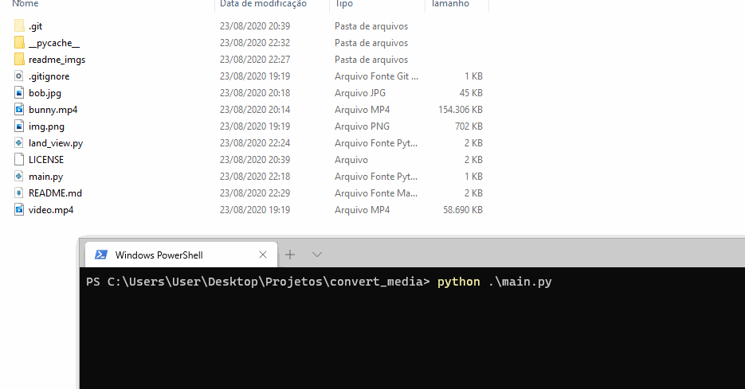
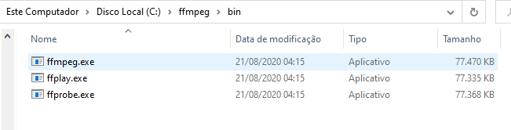

# :arrows_counterclockwise: ConvertMedia

Conversor simples de mídia com interface gráfica. Converte **imagens** (com
Pillow) e **áudio/vídeo** (com FFmpeg) de um formato para outro — por exemplo
`mp4 → mp3`, `mp4 → wav`, `png → jpg`.



## :package: O que você precisa

- **Python 3.9+**
- **Pillow** e **FreeSimpleGUI** (instalados via `pip`)
- **FFmpeg** instalado no sistema (só para áudio/vídeo)

## :arrow_down_small: Instalação

### 1. Bibliotecas Python

Na pasta do projeto:

```sh
pip install -r requirements.txt
```

(Isso instala o `Pillow` e o `FreeSimpleGUI` — fork livre do PySimpleGUI, que
passou a ser pago.)

### 2. FFmpeg

O FFmpeg é um programa à parte (não é um pacote `pip`). Instale conforme o seu
sistema:

**Windows**
- Jeito fácil (com um gerenciador de pacotes):
  ```sh
  winget install Gyan.FFmpeg
  ```
  ou, se usar o Chocolatey: `choco install ffmpeg`.
- Na mão: baixe um build em <https://www.gyan.dev/ffmpeg/builds/> (link oficial
  recomendado pelo projeto FFmpeg — o antigo `ffmpeg.zeranoe.com` saiu do ar),
  descompacte, e adicione a pasta **`bin`** (onde fica o `ffmpeg.exe`) à
  variável de ambiente **PATH**.

  

  Depois de alterar o PATH, feche e reabra o terminal (ou reinicie o PC).

**macOS**
```sh
brew install ffmpeg
```

**Linux (Debian/Ubuntu)**
```sh
sudo apt install ffmpeg
```

Para conferir se ficou tudo certo, rode:

```sh
ffmpeg -version
```

Se aparecer a versão, está no PATH e o programa vai encontrá-lo.

## :running: Como usar

Na pasta do projeto:

```sh
python main.py
```

1. Escolha **Imagem** ou **Vídeo / Áudio**.
2. Clique em **Procurar** e selecione o arquivo de entrada.
3. Digite o nome do arquivo de saída **com a extensão desejada** (é ela que
   define o formato): `musica.mp3`, `clipe.wav`, `foto.jpg`...
4. Clique em **Converter**. A mensagem de status mostra se deu certo.

### Exemplos

| Entrada | Saída | O que acontece |
| --- | --- | --- |
| `video.mp4` | `audio.mp3` | extrai o áudio em MP3 |
| `video.mp4` | `audio.wav` | extrai o áudio em WAV |
| `foto.png` | `foto.jpg` | converte a imagem para JPG |

## :mag: O que mudou nesta versão

- Migrado para **FreeSimpleGUI** e para a API atual da biblioteca (a versão
  antiga usava chamadas que não funcionam mais).
- Conversão de vídeo/áudio agora usa `subprocess` em vez de `os.system`, então
  funciona com nomes de arquivo que têm espaços e evita problemas de shell.
- Verifica se o arquivo existe e se o **FFmpeg** está instalado, mostrando o
  erro na própria janela em vez de falhar silenciosamente.
- Botão para procurar o arquivo e `requirements.txt` para instalar tudo de uma vez.
